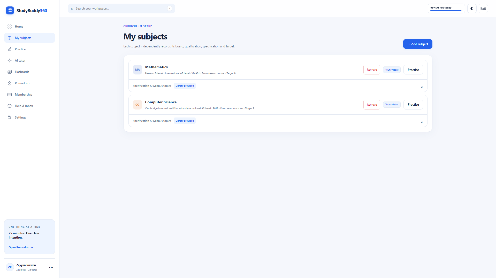
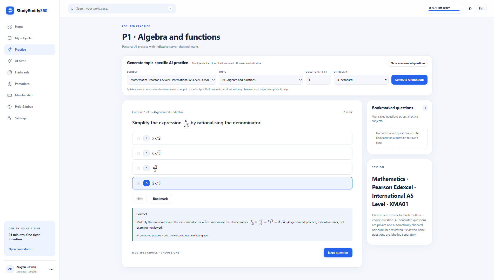
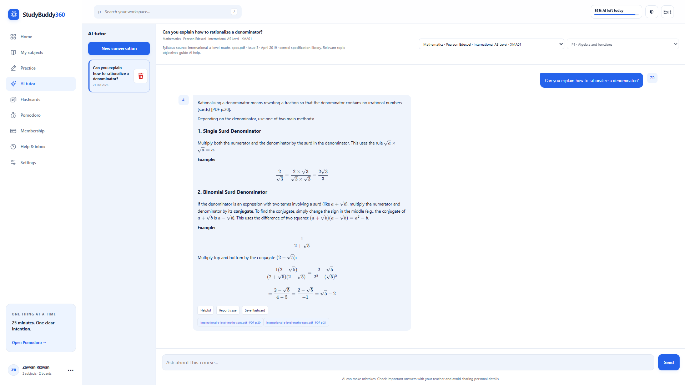
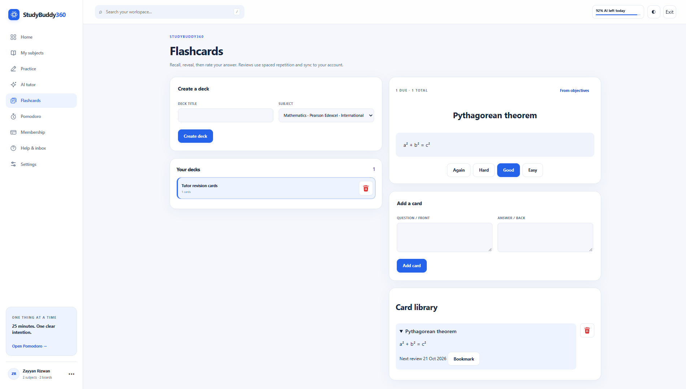
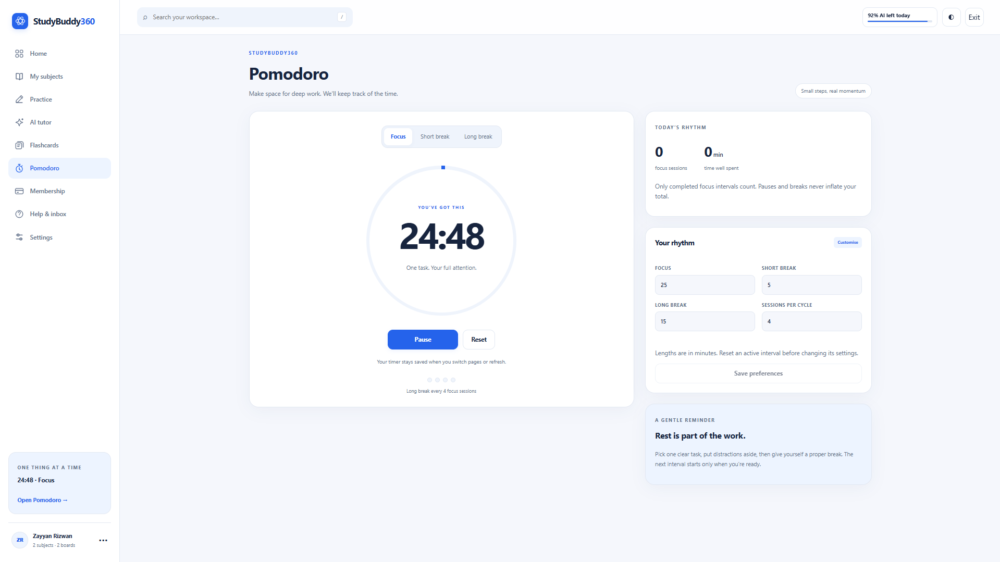

# StudyBuddy360

### Your subjects. Your tools. One workspace.

A syllabus-aware study workspace with AI tutoring, topic-based practice, flashcards, and focused study sessions.

**[Explore StudyBuddy360 ↗](https://studybuddy360.com)** &nbsp; / &nbsp; [Meet the developer ↗](https://zayyan.cc)

## Why StudyBuddy360?

Studying often means jumping between notes, questions, flashcards, and a separate timer. StudyBuddy360 brings those tools into one workspace, organised around the subject and specification you're working on.

The goal: less time organising your studying, more time understanding the material.

## Inside the workspace

| Tool | What it does |
| --- | --- |
| **My subjects** | Keep board, qualification, and specification details together, with topics from the published subject library. |
| **Practice** | Work through topic-based multiple-choice questions with hints, feedback, and worked explanations. |
| **AI tutor** | Ask questions with context from your selected subject and its published specification. |
| **Flashcards** | Organise decks, save useful tutor responses, and revisit material with spaced repetition. |
| **Pomodoro** | Run configurable focus and break sessions, with saved timer state and completed-session totals. |
| **Your workspace** | Use Google sign-in to keep subjects, study history, flashcards, and settings tied to your account. |

The interface includes responsive layouts, dark mode, accessibility preferences, and mathematical notation rendered with KaTeX.

## Take a closer look

<strong>Subjects — keep each course in its own space</strong>

Separate subjects retain their own board, qualification, specification, and topics.

<strong>Practice — work through a topic, then review your answers</strong>

Multiple-choice practice brings questions, feedback, and worked explanations together.

<strong>AI tutor — talk through the question you're working on</strong>

Get explanations with subject context and readable mathematical notation.

<strong>Flashcards — make the important things stick</strong>

Build decks and review cards with spaced repetition.

<strong>Focus sessions — make time for one task</strong>

Use a Pomodoro timer with configurable breaks and focus-session totals.

## How it works

1. **Choose your subject.** Select from the published board and qualification-specific library.
2. **Work through the material.** Switch between practice, tutoring, and flashcards as you study.
3. **Make room to focus.** Use a Pomodoro session to give the next task your attention.

## Built with

| Layer | Technologies |
| --- | --- |
| Application | Python · Django · Django REST Framework |
| Interface | JavaScript · HTML · CSS · KaTeX |
| Data and background work | PostgreSQL · Redis · Celery |
| Deployment | Docker · Nginx |

## About this repository

This repository is the public overview for StudyBuddy360. The application runs at **[studybuddy360.com](https://studybuddy360.com)**; the full application source is not currently included here.

## Built by Zayyan

Designed, developed, and deployed by **[Zayyan](https://github.com/zayyanr)**.

[Portfolio](https://zayyan.cc) &nbsp; / &nbsp; [LinkedIn](https://www.linkedin.com/in/zayyanrizwan/) &nbsp; / &nbsp; [Contact StudyBuddy360](mailto:contact@studybuddy360.com)
